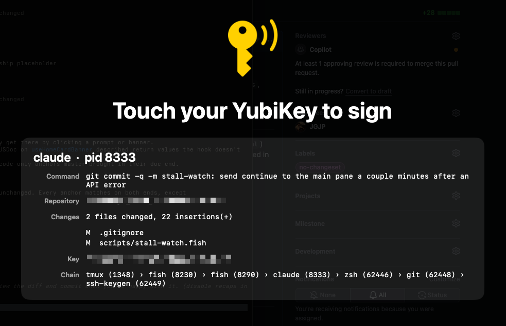

# YubiWatcher



A macOS menu bar app that makes it impossible to miss a YubiKey touch prompt when git signs a commit or tag with a FIDO (`sk-*`) SSH key.

When git starts waiting on `ssh-keygen -Y sign`, YubiWatcher plays a sound and covers every screen with an overlay showing:

- what asked for the signature (e.g. your terminal, editor, or an AI agent) and the full process chain
- the git command and repository
- the files and line counts in the commit being signed
- the key being used

The overlay disappears as soon as you touch the key (or signing times out).

## Requirements

- macOS 14+
- Swift 6 toolchain (Xcode or Command Line Tools)
- git configured for SSH signing with a security key:

  ```sh
  git config --global gpg.format ssh
  git config --global user.signingkey ~/.ssh/id_ed25519_sk.pub
  git config --global commit.gpgsign true
  ```

- Optional: [libfido2](https://github.com/Yubico/libfido2) (`brew install libfido2`) to show connected YubiKey details (firmware, PIN status, resident key slots) in the menu

## Install

```sh
make install   # builds, copies to ~/Applications and launches
```

Other targets: `make app` (build `build/YubiWatcher.app`), `make run` (build and launch without installing), `make clean`.

Enable **Launch at Login** from the menu bar icon to start it automatically.

## Usage

The key icon in the menu bar offers:

- **Connected YubiKey N** – details for each connected key (requires libfido2)
- **Test (touch YubiKey)** – runs a real signature with your configured `user.signingkey` so you can see the overlay
- **Launch at Login**

## How it works

YubiWatcher polls the process table for `ssh-keygen -Y sign -n git` using a security key. It walks the process ancestry to find who triggered git, and reads the index git is committing from to show the pending changes. No elevated permissions are needed and nothing is sent anywhere.

## License

[MIT](LICENSE)
